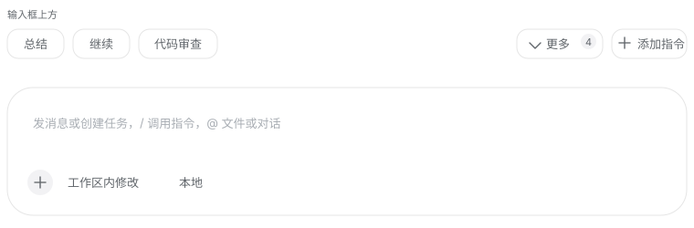

# DSH Prompt Shortcuts

把常用提示词存成输入框上方的一排快捷按钮，点一下就能填进输入框。



一个 [DeepSeek Harness](https://github.com/deepseek-ai) 插件。装好之后，每次打开会话都能看到自己预设的提示词按钮，不用再反复手打或者去别处复制粘贴。

## 功能

**输入框上方的快捷按钮栏**

每个置顶的提示词是一个按钮，点击后**替换**输入框当前内容。鼠标悬停可以看到完整提示词。

**自动收纳**

按钮排不下时不会换行，放不下的会自动收进「更多」。按钮栏始终是一行，窗口拉窄也不会变形。

**「更多」下拉菜单**

列出所有没显示在按钮栏上的提示词（包括你手动取消置顶的，以及因为位置不够被收起来的）。点一条直接填入。

**添加与维护**

点「添加指令」打开维护面板：

- 卡片网格展示所有提示词，带搜索框
- 每张卡片可以**编辑**、**置顶/取消置顶**、**删除**（删除有二次确认）
- 点卡片本身就是填入输入框

## 安装

需要 DSH 的 Agent 会话来执行安装。在会话中让 Agent 运行 `plugin_manager` 的 `install_bundle`，`target` 指向本仓库的绝对路径。

或者直接把这句话发给 Agent：

> 把 /path/to/dsh-actions 这个目录作为 bundle 安装到当前 profile

安装后刷新页面即可生效。

## 使用

| 操作 | 结果 |
|---|---|
| 点按钮栏上的提示词 | 替换输入框内容 |
| 点「更多」 | 展开未显示的提示词列表 |
| 点「添加指令」 | 打开维护面板 |
| 面板里点卡片 | 填入输入框并关闭面板 |
| 面板里点「编辑」 | 修改名称和内容 |
| 面板里点「置顶」 | 控制是否显示在按钮栏上 |
| 面板里点「删除」 | 删除（需二次确认） |

**关于「置顶」**：它就是这个提示词要不要出现在输入框上方。每条提示词都可以单独控制，所以你可以存很多条，只把最常用的几个放出来。

## 数据存储

提示词存在浏览器的 `localStorage`，键名 `dsh-prompt-shortcuts/v1`。

这意味着：

- 数据只在本机、本浏览器配置里，不上传
- 换浏览器或清空浏览器数据会丢失
- 可以自己导出备份：在开发者工具里执行 `localStorage.getItem('dsh-prompt-shortcuts/v1')`

首次使用时会有三条示例提示词，可以自行修改或删除。

## 设计说明

插件挂在 `conversation.input.dock` 槽位上——DSH 把它定义为「输入框上方的整宽条目」，和官方的排队提示条是同一个位置。所以按钮栏天然就在输入框正上方，不需要靠定位去凑。

样式全部使用 DSH 的主题变量（`--dsw-alias-*`、`--dsw-radius-*`），因此自动跟随明暗主题和字号设置。按钮的视觉语言对齐了输入框卡片本身：白底、无实线边框（靠 `.5px` 阴影描边）、柔和投影。

按钮的宽度是**实测**的，不是按字符数估算——中文和英文混排、字号变化时估算都会失准。插件在屏幕外渲染一份副本量出真实宽度，再用 `ResizeObserver` 跟踪变化。

## 已知限制

**Agent 无法读写这些提示词。** 数据是纯浏览器状态（localStorage），没有走 Host 侧存储。如果想实现「让 Agent 帮我加一条提示词」，需要补一套 Client↔Host 的 Remote 契约。

**图标是内联的。** DSH 的图标集 `@deepseek-ai/dsh-client-ui-primitives` 不对插件开放导入，所以这几个图标的 SVG 路径是复制进来的。如果 DSH 之后改了图标，这里不会自动跟着变。

**只支持单行文本。** 提示词内容不支持变量、模板或附件。

## 文件结构

```
dsh-actions/
├── package.json         插件清单（dsh.bundle 与 dsh.client 声明）
├── cordis.patch.yml     Cordis 加载器的插件行插入
├── index.js             Host 半边（当前为空实现）
├── client.js            全部界面逻辑
└── icon.svg             插件图标
```

`client.js` 包含数据模型、持久化、按钮栏、弹出菜单和维护面板。没有构建步骤，改完文件重装 bundle 即可。

## 开发

改 `client.js` 后需要重装 bundle 并刷新页面。因为 bundle 以 `link:` 方式安装，文件改动会直接生效，但要等浏览器重新加载模块。

## 许可

MIT
