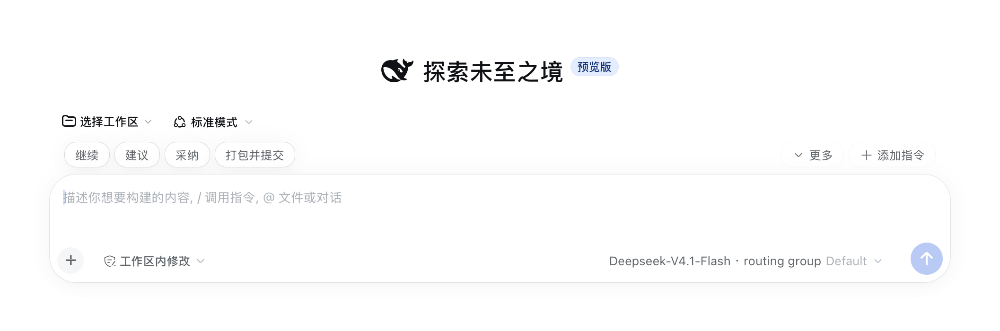
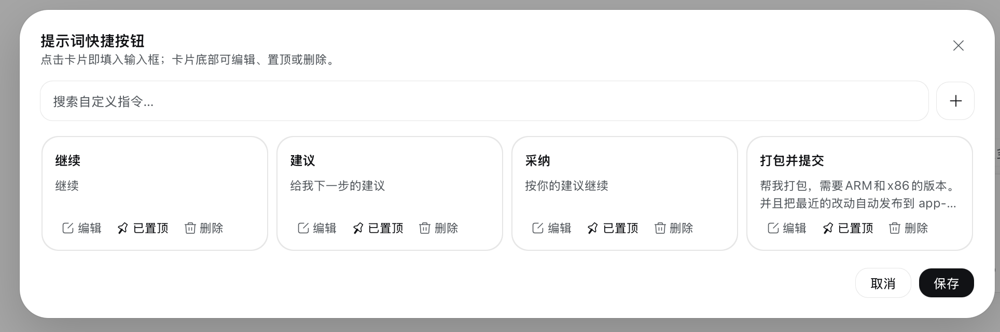
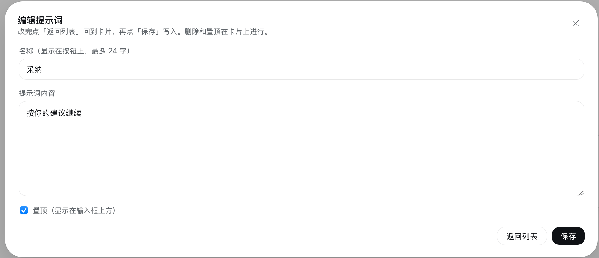

# DSH Prompt Shortcuts

把常用提示词存成输入框上方的一排快捷按钮，点一下就能填进输入框。




一个 DeepSeek Harness 插件。装好之后，每次打开会话都能看到自己预设的提示词按钮，不用再反复手打或者去别处复制粘贴。

## 界面

**维护面板**——点「添加指令」打开，卡片网格列出全部提示词，支持搜索；卡片底部可直接编辑、置顶或删除。



**编辑单条**——点卡片上的「编辑」进入，改完点「返回列表」回卡片，再点「保存」写入。



## 功能

**输入框上方的快捷按钮栏**

每个置顶的提示词是一个按钮，点击后**替换**输入框当前内容。鼠标悬停可以看到完整提示词。

**自动收纳**

按钮排不下时不会换行，放不下的会自动收进「更多」。按钮栏始终是一行，窗口拉窄也不会变形。

**「更多」下拉菜单**

列出所有没显示在按钮栏上的提示词（包括你手动取消置顶的，以及因为位置不够被收起来的）。点一条直接填入。

**添加与维护**

点「添加指令」打开维护面板：

- 卡片网格展示所有提示词，带搜索框
- 每张卡片可以**编辑**、**置顶/取消置顶**、**删除**（删除有二次确认）
- 点卡片本身就是填入输入框

**关于「置顶」**：它就是这个提示词要不要出现在输入框上方。每条提示词都可以单独控制，所以你可以存很多条，只把最常用的几个放出来。

## 安装

推荐从 npm 安装已发布的稳定版本：

```sh
dsh plugin --profile web add @cdredfox/dsh-prompt-shortcuts
```

把 `web` 换成你实际使用的 profile 名（例如 `tauri`）。安装完成后**重启 `dsh web`、刷新浏览器**，按钮栏就会出现在输入框上方。

安装过程会把这个包加入 profile 的依赖和 bundle 列表；卸载用：

```sh
dsh plugin --profile web remove @cdredfox/dsh-prompt-shortcuts
```

**从源码安装**（想改代码或试用未发布版本时）：

```sh
git clone https://github.com/cdredfox/dsh-prompt-shortcuts.git
cd dsh-prompt-shortcuts
dsh plugin --profile web add "$PWD"
```

### 环境要求

- DSH 版本需包含 `conversation.input.dock` 槽位
- 浏览器端依赖 `@deepseek-ai/dsh-client-store`（DSH Web 自带，无需单独安装）
- 无构建步骤、无运行时依赖：`index.js` 与 `client.js` 直接就是可加载的模块

### 升级后请注意

`1.1.0` 起提示词改存到 Host 的 JSON 文件（见[数据存储](#数据存储)）。`1.0.x` 存在浏览器 `localStorage` 里的旧数据**不会自动迁移**——首次升级后看到的是三条默认提示词，需要按需重新录入。

从 `1.0.x` 升级前，可以先在浏览器开发者工具里导出旧数据：

```js
localStorage.getItem('dsh-prompt-shortcuts/v1')
```

## 使用

| 操作 | 结果 |
|---|---|
| 点按钮栏上的提示词 | 替换输入框内容 |
| 点「更多」 | 展开未显示的提示词列表 |
| 点「添加指令」 | 打开维护面板 |
| 面板里点卡片 | 填入输入框并关闭面板 |
| 面板里点「编辑」 | 修改名称和内容 |
| 面板里点「置顶」 | 控制是否显示在按钮栏上 |
| 面板里点「删除」 | 删除（需二次确认） |

## 数据存储

提示词存成 Host 侧的一个 JSON 文件：

```
$DSH_HOME/prompt-shortcuts.json     # 未设置 DSH_HOME 时为 ~/.dsh/prompt-shortcuts.json
```

数据归 DSH 所有，**不随浏览器缓存丢失**——换浏览器、换设备、清空站点数据都不影响。

写入采用**原子替换**（先写临时文件再 `rename`），并且所有写入串行排队：写一半被打断不会留下损坏文件，连续快速保存也不会互相覆盖。文件是普通 JSON，可以直接查看、用 Git 管理或手工编辑（手工改坏的行会在下次读取时被跳过，不会让按钮栏整体失效）。

结构很简单：

```json
{
  "shortcuts": [
    { "id": "seed-continue", "label": "继续", "prompt": "继续", "enabled": true }
  ]
}
```

`enabled` 表示这一条是否出现在输入框上方。

**路径可覆盖**：插件行支持两个可选配置项——`dshHome`（替换 `$DSH_HOME`）和 `file`（直接指定文件路径），用于多环境或同步目录。

首次使用时会有三条默认提示词（继续 / 建议 / 采纳），可以自行修改或删除。

## Agent 也能读写

除了界面操作，插件还注册了一个 Agent 工具 `prompt_shortcuts`，可以直接在对话里让 Agent 维护提示词：

> 帮我加一条提示词，名字叫「跑测试」，内容是「运行全部测试并修复失败项」

> 把「建议」那条改成「给我三个可选方案，并说明取舍」

工具支持 `list` / `save` / `remove` 三个动作，与界面走同一份存储和同一套校验，不存在两边数据不一致的问题。

## 设计说明

插件挂在 `conversation.input.dock` 槽位上——DSH 把它定义为「输入框上方的整宽条目」，和官方的排队提示条是同一个位置。所以按钮栏天然就在输入框正上方，不需要靠定位去凑。

样式全部使用 DSH 的主题变量（`--dsw-alias-*`、`--dsw-radius-*`），因此自动跟随明暗主题和字号设置。按钮的视觉语言对齐了输入框卡片本身：白底、无实线边框（靠 `.5px` 阴影描边）、柔和投影。

按钮的宽度是**实测**的，不是按字符数估算——中文和英文混排、字号变化时估算都会失准。插件在屏幕外渲染一份副本量出真实宽度，再用 `ResizeObserver` 跟踪变化。

浏览器端通过插件自有的 HTTP 路由 `/api/dsh-prompt-shortcuts` 读写数据（`POST`，JSON），而不是绕道通用 RPC——路径是写死的，出问题时可以直接用 curl 验证。

## 已知限制

**图标是内联的。** DSH 的图标集 `@deepseek-ai/dsh-client-ui-primitives` 不对插件开放导入，所以这几个图标的 SVG 路径是复制进来的。如果 DSH 之后改了图标，这里不会自动跟着变。

**只支持纯文本。** 提示词内容不支持变量、模板或附件。

**按钮栏只读，编辑在面板里。** 想改内容要点「添加指令」进面板，按钮本身只负责填入。

## 文件结构

```
dsh-prompt-shortcuts/
├── package.json         插件清单（dsh.bundle 与 dsh.client 声明）
├── cordis.patch.yml     Cordis 加载器的插件行插入
├── index.js             Host 半边：文件存储、HTTP 路由、Agent 工具
├── client.js            全部界面逻辑
├── icon.svg             插件图标
├── docs/
│   ├── preview-row.png  按钮栏截图
│   ├── m1.png           维护面板截图
│   └── m2.png           编辑提示词截图
└── LICENSE              MIT
```

`index.js` 是 Host 半边：`ShortcutStore` 负责读写与校验，`webServer` 路由暴露给浏览器，`prompt_shortcuts` 工具暴露给 Agent——三者共用同一份实现。`client.js` 只负责界面，不含任何持久化逻辑。整个包没有构建步骤，也没有运行时依赖。

## 开发

改代码后重装 bundle 并重启 `dsh web`：

```sh
dsh plugin --profile web add "$PWD"   # 或 remove 后重新 add
```

Host 半边（`index.js`）的改动**必须重启进程**才生效；只有浏览器端 `client.js` 的改动可以靠刷新页面或内置 HMR 加载。

调试数据接口时可以直接 curl（`$TOKEN` 取启动日志里 `?token=` 后面的值）：

```sh
curl -X POST "http://127.0.0.1:3080/api/dsh-prompt-shortcuts?token=$TOKEN" \
  -H 'content-type: application/json' \
  -d '{"action":"list"}'
```

发布新版本：

```sh
npm version minor   # 或 patch / major
npm publish
```

`publishConfig` 已固定为官方 registry 与 public access，无需额外参数。若 npm 开启了 2FA，`npm publish` 会要求完成一次浏览器验证。

## 更新日志

### 1.1.1

- 插件列表里显示中文名称和描述（新增 `locale/zh.json` 与 `locale/en.json`），不再是原始包名
- README 换成真机截图

### 1.1.0

- **提示词改存 Host 文件**（`$DSH_HOME/prompt-shortcuts.json`），不再使用浏览器 `localStorage`，清理浏览器数据不会再丢
- 新增 `prompt_shortcuts` Agent 工具，可以在对话里让 Agent 增删改提示词
- 默认提示词改为「继续 / 建议 / 采纳」
- 修复安装包更名后客户端模块 id 未同步导致的启动失败

**升级须知**：`1.0.x` 的 `localStorage` 数据不会自动迁移。

### 1.0.0

首个版本：输入框上方的快捷按钮栏、置顶控制、溢出自动收纳、维护面板。

## 贡献

Issue 和 PR 都欢迎：https://github.com/cdredfox/dsh-prompt-shortcuts

## 许可

[MIT](LICENSE)
